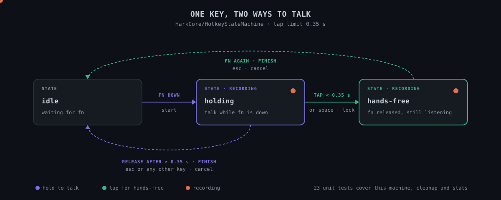
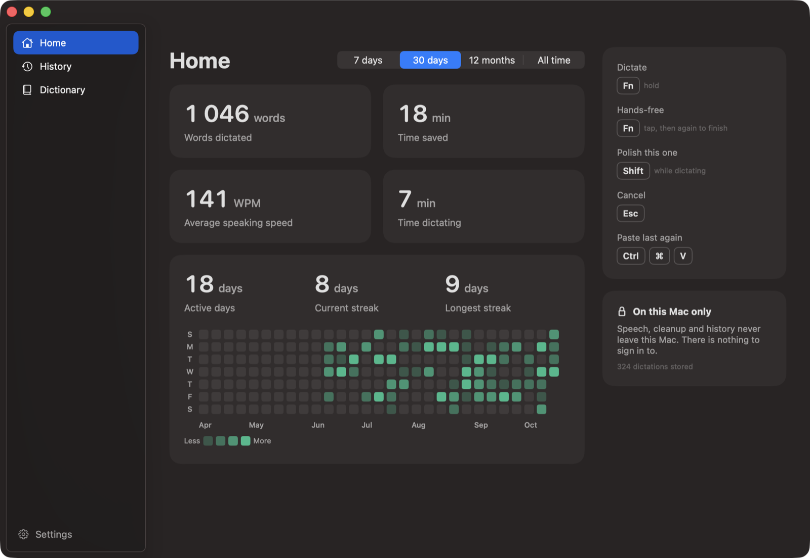
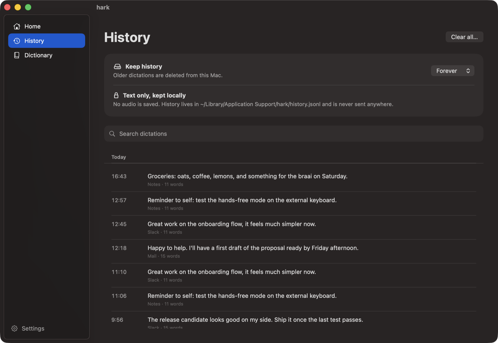
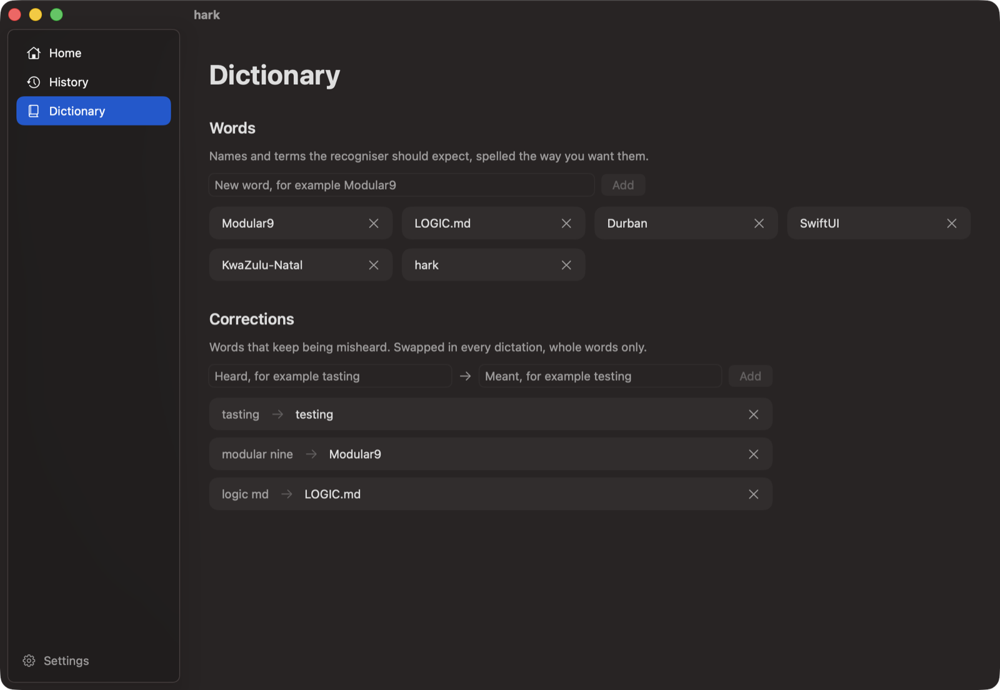

# hark

**Hold a key, speak, release: your words are typed into whatever app has the cursor.**

A small macOS menu bar app for dictation. Speech recognition runs on the Mac. Cleanup
removes hesitation, repeats and anything you take back ("wait, sorry, it's the other
one"), using Apple's on-device model by default or, if you set one, a free LLM server such
as [FreeLLMAPI](https://github.com/tashfeenahmed/freellmapi). No account, no telemetry,
nothing paid for. Native Swift with zero third-party dependencies. Personal tool for two
people; not for distribution.


<p align="center">
  
</p>

---

## Why it exists

Typeless does this job well, but it does it in the cloud. Studying its behaviour
(`docs/findings.md`) showed three things worth avoiding:

**Your words leave the Mac.** Speech, cleanup, and context from the screen and the
surrounding text are sent to its servers.

**It is heavy for what it does.** 181 MB resident across 7 processes while idle, 529 MB
on disk.

**It needs an account.** Sign-in, sync, telemetry and auto-update come with it.

macOS 26 ships an on-device speech recogniser and an on-device language model, so the
same hold-to-talk workflow can run entirely locally. hark is that, and nothing more.

---

## How it works

One real dictation through each stage, using the outputs of `hark --clean` and
`hark --refine`:

<p align="center">
  
</p>

The polish step is checked before use: if the model's answer does not look like a
cleaned-up version of what you said, hark discards it and uses the instant cleanup.

---

## When to use it, and when not to

**Use hark when:**
- You want hold-to-talk dictation in any app, with nothing sent off the Mac.
- You have an Apple silicon Mac on macOS 26 or later.
- A few words the recogniser keeps mishearing can be fixed with a lookup list.

**It is the wrong tool when:**
- Your Mac runs macOS 25 or earlier. There is no fallback engine.
- You need translation, voice commands, or sync across devices. None are built.
- You use a non-QWERTY layout. The paste sends a fixed V key code.
- You need text in password fields or apps that block pasting.

---

## Requirements

- Apple silicon Mac on macOS 26 or later.
- Xcode or the Xcode Command Line Tools (`xcode-select --install`).
- Optional: Apple Intelligence switched on, for the "polish" feature.

## Install

```sh
git clone <this repo> hark    # or copy the folder
cd hark
make install
```

`make install` builds the app, puts it in `/Applications/hark.app` and starts it. A
microphone icon appears in the menu bar. Then:

1. Allow **Microphone** when macOS asks.
2. Allow **Accessibility** when macOS asks (System Settings > Privacy & Security >
   Accessibility). The hotkey and the paste both need it. hark picks the grant up within
   two seconds, no restart needed.
3. Nothing to do for the Fn key: `make install` sets System Settings > Keyboard >
   "Press 🌐 key to" to **Do Nothing**, because otherwise Fn also opens the emoji picker
   and your words land in its search field. The picker stays on Ctrl+Cmd+Space. To undo,
   pick another option in that same Keyboard setting.

Check what this Mac supports at any time:

```sh
/Applications/hark.app/Contents/MacOS/hark --doctor
```

---

## Use

| Action | Keys |
| --- | --- |
| Dictate | Hold **Fn**, speak, release |
| Hands-free | Tap **Fn** once, speak, press Fn again to finish. Space while holding Fn does the same |
| Skip polish for this one | Tap **Shift** while dictating |
| Cancel | **Esc** |
| Paste the last result again | **Ctrl+Cmd+V** |

<p align="center">
  
</p>

Other audio is muted while you dictate and comes back when you stop, so a video or music
is not picked up by the microphone. Turn that off in Settings > General.

The trigger key, language, microphone and personal dictionary are in the menu bar icon >
Settings. The menu also lists the last five dictations; click one to copy it.

### The hark window

Menu bar icon > **Open hark…** (or open hark again from Finder or Spotlight) shows a
window with three pages, all read from the history file on this Mac:

- **Home**: words dictated, time saved, speaking speed and time spent dictating over the
  last 7 days, 30 days, 12 months or all time; active days, current and longest streak;
  and a grid of words per day. "Time saved" compares against typing at 40 words a minute.
- **History**: every dictation grouped by day, searchable. Right-click to copy what was
  pasted, copy what was heard, or delete it. Choose how long history is kept.
- **Dictionary**: the words the recogniser should expect and the corrections list, with
  add and remove buttons.

<p align="center">
  
</p>

<p align="center">
  
  
</p>

<sub>Screenshots use sample data, not real dictations.</sub>

### Corrections

When a word keeps coming out wrong, add it under Settings > Corrections as
`heard = meant`, one per line (for example `tasting = testing`). It is swapped in every
dictation, whole words only, before cleanup runs.

### Cleanup

Every dictation gets instant cleanup with no model: filler sounds ("um", "uh", "hmm",
"ah"), repeated words and phrases ("I'm going to I'm going to"), and "you know" used as
filler are removed, and sentence capitals are fixed.

Then polish, on by default, hands the text to a language model told to keep only what you
meant: "so I need to go to this website, uh, wait sorry, it's an email in my gmail, oh no
wait, sorry, it's a conversation in whatsapp" becomes "I need to go to a conversation in
WhatsApp." Its answer is thrown away if it does not read as a cleanup of your own words.

### Polish server

By default polish uses Apple's on-device model, and nothing leaves the Mac. It is not
clever enough for heavy self-correction (11 of 15 `make eval` cases). For better results,
set an OpenAI-compatible server under Settings > Polish server. With
[FreeLLMAPI](https://github.com/tashfeenahmed/freellmapi) running in Docker:

- URL `http://localhost:3001/v1`, model `auto`, and the unified API key from its Keys page
  (stored in the macOS keychain).
- At least one free provider key added in FreeLLMAPI, for example Groq.

**With a server set, every polished dictation is sent to it, and FreeLLMAPI forwards it to
whichever free cloud provider its router picks.** Free tiers may keep or train on what
they receive. If the server fails or takes over 10 seconds, hark pastes the instant
cleanup instead. Leave the URL empty to keep everything on the Mac.

---

## Status

- In daily use since 2026-10-13. Dictation, tap-to-toggle hands-free, muting of other
  audio and the Fn key were confirmed with real speech.
- **29 unit tests** passing (`make test`) for the hotkey state machine, cleanup rules,
  stats and sounds.
- **Polish eval** (`make eval`): 15 hesitant or self-correcting sentences. Through
  FreeLLMAPI `auto`: 15 of 15, median 0.47 s, slowest 9 s. Apple's on-device model: 11
  of 15 (2026-10-14).
- **End-to-end speech check** without a microphone (`make verify`), including the live
  streaming path and a recording with no audio in it.
- **14 MB** footprint at launch, **21 MB** after 19 hours running, about **36 MB** while
  the hark window is open and **33 MB** after closing it, flat over three open and close
  cycles (2026-10-14). A rise past 60 MB is treated as a regression.

---

## Measured, honestly

**Footprint.** hark uses 21 MB in one process after 19 hours running, and its app bundle
is 648 KB. Typeless idles at 181 MB across 7 processes and takes 529 MB on disk.

<p align="center">
  
</p>

**Polish.** Measured with `make eval` on 2026-10-14:

| Engine | Passed | Time |
| --- | --- | --- |
| FreeLLMAPI, model `auto` | 15 of 15 | median 0.47 s, slowest 9 s |
| Apple on-device model | 11 of 15 | 0.7 to 0.9 s warm, 4 to 10 s for long or cold |
| FreeLLMAPI, a single pinned model | 7 to 11 of 15 | pinned models were rate-limited, missing or timed out |

Pin nothing: `auto` moves to the next free model when one is rate-limited. Apple's model
once answered a dictated question instead of cleaning it, which is why every polish
answer is checked before use.

**Accents.** Measured on a South African voice on 2026-10-13, saying "testing" (heard as
"tasting"):

| Engine | Correct |
| --- | --- |
| Apple en-ZA | 1 of 2 |
| Apple en-GB | 1 of 2 |
| Apple en-US | 0 of 2 |
| Apple en-AU | 0 of 2 |
| whisper.cpp small.en | 0 of 2, about five times slower |

Adding the word to the recogniser's dictionary changed nothing. Switching engine does not
fix accent mishearings; the Corrections list does.

**Not yet measured:** key-release-to-text latency, insertion into Electron apps and
browser fields, and the microphone picker.

---

## Limits

- Needs macOS 26 for Apple's on-device speech recogniser. There is no fallback engine yet;
  `Transcriber` in `Sources/hark/Transcriber.swift` is the place to add one.
- Languages are whatever Apple's recogniser supports (30 locales, including `en-ZA`).
- Insertion is a paste, so apps that block pasting will not receive text.
- Password fields: macOS hides key events there, so the hotkey does not fire.
- The paste uses a fixed V key code, so non-QWERTY layouts may paste the wrong key.
- Muting uses the output device's own mute control. Outputs without one (some HDMI
  displays) are left alone; `hark --doctor` says which case applies.

---

## Roadmap

**Next**
- Confirm the second user's Mac runs macOS 26.
- Prove `make install`'s Fn key step on a fresh Mac.
- Measure key-release-to-text latency (median of 10) and record a demo into `docs/`.
- Check insertion in an Electron app and a browser field; test the microphone picker.

**Later**
- A fallback speech engine for Macs older than macOS 26.
- A layout-aware paste key.

---

## Develop

```sh
make test      # unit tests for the hotkey logic and the cleanup rules
make verify    # synthesises a sentence, transcribes it two ways, compares the words
make eval      # 15 hesitant sentences through polish; set HARK_POLISH_URL/MODEL/KEY to test a server
make app       # builds build/hark.app without installing
```

`make` signs with your Apple Development certificate when you have one, so macOS keeps
the permission grants across rebuilds. Without one it signs ad hoc, which works but asks
for Microphone and Accessibility again after each rebuild.

Layout:

- `Sources/HarkCore`: pure logic (hotkey state machine, rule-based cleanup, corrections,
  dictation stats and the activity grid), unit tested.
- `Sources/hark`: the app (event tap, audio capture, Apple speech, cleanup model, paste,
  indicator, settings, history, the hark window).
- `docs/findings.md`: what was learned from studying Typeless and what hark does instead.

**Stack:** Swift 6.2 toolchain, SwiftPM, AppKit, SwiftUI for settings and the indicator, Apple `Speech`
(`SpeechAnalyzer`, `SpeechTranscriber`) and `FoundationModels`. No third-party packages.

Data lives in `~/Library/Application Support/hark/history.jsonl` (text only) and in the
app's preferences. Delete both to reset.

When a dictation misbehaves, hark's log has the timings and outcome (never the words):

```sh
log show --last 5m --predicate 'subsystem == "dev.hark.app"'
```
